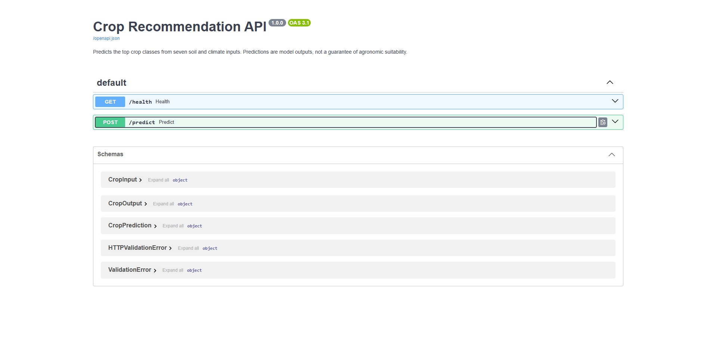
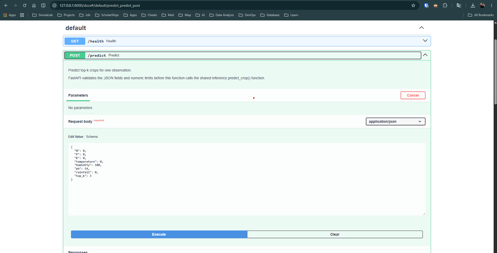
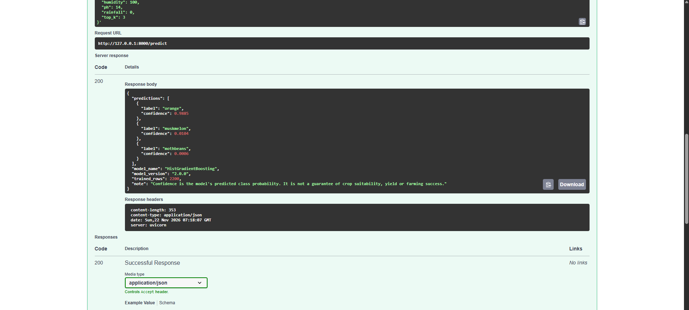

# Crop Recommendation API

A FastAPI-based REST API for serving predictions from the trained Crop Recommendation Machine Learning model.

This API provides crop recommendations based on soil nutrient measurements and environmental conditions. It loads the trained model generated by the project's ML training pipeline and returns the top predicted crop classes.

> **Note:** This file documents the API component. For the complete project overview, dataset details, and machine learning methodology, see the main [README.md](README.md).

## Features

- REST API built with FastAPI.
- Predicts the most suitable crop classes from seven input features.
- Returns configurable top-k crop predictions.
- Includes model metadata in prediction responses.
- Loads the trained model once and reuses it for subsequent requests.
- Provides automatic request validation through Pydantic.
- Interactive API documentation through Swagger UI.
- Supports direct Python predictions without starting an HTTP server.
- Includes a command-line testing mode.

## API Architecture

The API uses the existing machine learning pipeline and inference module.

```text
Client / Frontend
       |
       v
   FastAPI API
       |
       v
   POST /predict
       |
       v
   Request Validation
       |
       v
   inference.py
       |
       v
   Trained Model Bundle
       |
       v
   Top-K Crop Predictions
       |
       v
   JSON Response
```

### Project Integration

The API does not train a model. It loads the model bundle generated by the training pipeline.

Expected model location:

```text
ml/
├── artifacts/
│   └── crop_recommendation/
│       └── crop/
│           └── model.joblib
├── src/
│   ├── crop_api.py
│   ├── inference.py
│   └── train_all.py
```

The API uses:

- `crop_api.py` — defines the HTTP endpoints and request validation.
- `inference.py` — loads the model bundle and performs crop predictions.
- `train_all.py` — trains, evaluates, and saves the machine learning model.

## Input Features

The prediction endpoint accepts seven numerical input features.

| Feature       | Description                  |
| ------------- | ---------------------------- |
| `N`           | Nitrogen measurement         |
| `P`           | Phosphorus measurement       |
| `K`           | Potassium measurement        |
| `temperature` | Temperature in dataset units |
| `humidity`    | Relative humidity (%)        |
| `ph`          | Soil pH                      |
| `rainfall`    | Rainfall in dataset units    |

The input measurements must use the same units and definitions as the training dataset.

An additional parameter, `top_k`, controls how many crop suggestions are returned. Its default value is `3`.

## Installation

Run the following commands from the repository root.

### 1. Create a virtual environment

```bash
python -m venv .venv
```

Activate it on Windows:

```bash
.venv\Scripts\activate
```

Activate it on Linux or macOS:

```bash
source .venv/bin/activate
```

### 2. Install API dependencies

```bash
pip install fastapi "uvicorn[standard]" pydantic
```

Install the remaining dependencies required by the project's inference module and saved model, using your project's existing requirements or environment configuration.

## Running the API

Start the API from the repository root:

```bash
uvicorn ml.src.crop_api:app --reload
```

The API will be available at:

```text
http://127.0.0.1:8000
```

### Interactive API Documentation

FastAPI automatically generates interactive documentation.

Open:

```text
http://127.0.0.1:8000/docs
```

You can test the endpoints directly from Swagger UI.

## API Endpoints

### 1. Health Check

**GET** `/health`

Checks whether the API service is responding.

Example:

```bash
curl http://127.0.0.1:8000/health
```

Example response:

```json
{
  "status": "ok",
  "service": "crop-recommendation"
}
```

This is a service health check; it does not verify that the model bundle exists or can be loaded.

### 2. Crop Prediction

**POST** `/predict`

Accepts soil and environmental measurements and returns the top crop predictions.

#### Request Body

```json
{
  "N": 90,
  "P": 42,
  "K": 43,
  "temperature": 20.8,
  "humidity": 82,
  "ph": 6.5,
  "rainfall": 202.9,
  "top_k": 3
}
```

#### Example cURL Request

```bash
curl -X POST "http://127.0.0.1:8000/predict" \
  -H "Content-Type: application/json" \
  -d '{
    "N": 90,
    "P": 42,
    "K": 43,
    "temperature": 20.8,
    "humidity": 82,
    "ph": 6.5,
    "rainfall": 202.9,
    "top_k": 3
  }'
```

#### Example Response

The following illustrates the response structure. Actual crop labels and confidence values depend on the loaded model and input measurements.

```json
{
  "predictions": [
    {
      "label": "example_crop_1",
      "confidence": 0.95
    },
    {
      "label": "example_crop_2",
      "confidence": 0.03
    },
    {
      "label": "example_crop_3",
      "confidence": 0.02
    }
  ],
  "model_name": "HistGradientBoosting",
  "model_version": "1.0",
  "trained_rows": 2200,
  "note": "Confidence is the model's predicted class probability. It is not a guarantee of crop suitability, yield or farming success."
}
```

The response metadata depends on the information stored in the model bundle. The example above is illustrative, not a verified live API response.

## Using the API Directly from Python

The same prediction functionality can be called without starting the FastAPI server.

```python
from ml.src.crop_api import predict_record

result = predict_record({
    "N": 90,
    "P": 42,
    "K": 43,
    "temperature": 20.8,
    "humidity": 82,
    "ph": 6.5,
    "rainfall": 202.9,
    "top_k": 3
})

print(result)
```

This is useful when integrating the model into another Python application or backend service.

## Command-Line Testing

The API module also supports one-record prediction from the terminal.

```bash
python ml/src/crop_api.py --once "{\"N\":90,\"P\":42,\"K\":43,\"temperature\":20.8,\"humidity\":82,\"ph\":6.5,\"rainfall\":202.9,\"top_k\":3}"
```

This mode runs the prediction without starting the HTTP server.

## Request Validation and Error Handling

The API validates incoming data using Pydantic.

| Field         | Validation                    |
| ------------- | ----------------------------- |
| `N`, `P`, `K` | Must be zero or greater       |
| `humidity`    | Between 0 and 100             |
| `ph`          | Between 0 and 14              |
| `rainfall`    | Must be zero or greater       |
| `top_k`       | Between 1 and 22              |
| `temperature` | Must be a valid numeric value |

Common HTTP responses:

| Status | Meaning                                  |
| ------ | ---------------------------------------- |
| `200`  | Successful request                       |
| `422`  | Invalid request data or prediction input |
| `503`  | Trained model bundle not found           |
| `500`  | Model loading or prediction failure      |

## Model Loading

The model is loaded lazily when the first prediction request is received.

After the initial load, the API reuses the model bundle for subsequent requests within the same application process.

If the model file is missing, the API returns a `503` response. Run the machine learning training pipeline before using the prediction endpoint.

## Screenshots

Structure:

```text
ml/
└──reports  
  └── screenshots/
      ├── swagger-ui.png
      ├── prediction-request.png
      └── prediction-response.png
```

```markdown

## API Demo

### Swagger UI


### Prediction Request


### Prediction Response


```

## Limitations

- Predictions depend on the quality and coverage of the training dataset.
- Dataset measurements must use the correct units.
- Model confidence is not a guarantee of real-world crop suitability.
- Actual farming decisions should also consider local climate, soil conditions, irrigation, season, and agronomic guidance.
- The API does not retrain the model or update it automatically.

## Related Documentation

- [Main Project README](README.md)
- [FastAPI Documentation](https://fastapi.tiangolo.com/)
- [Scikit-learn Documentation](https://scikit-learn.org/stable/)

---
