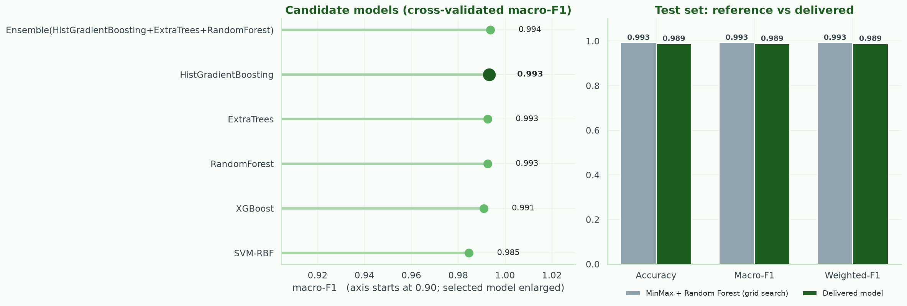
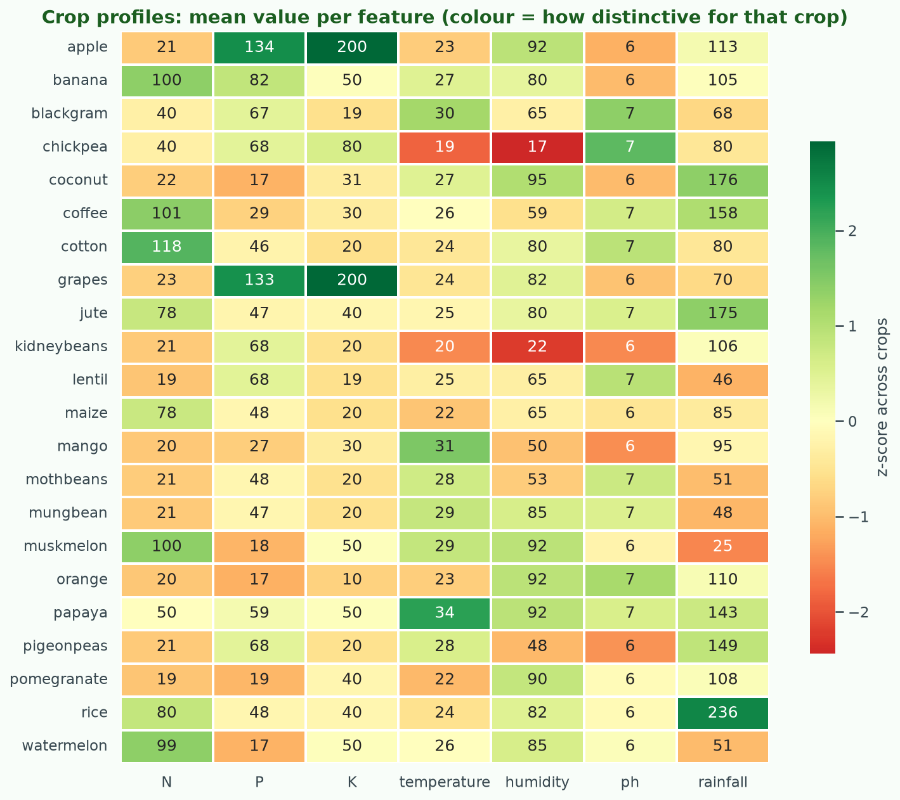

# AI Crop Recommendation System

**A trained, validated and packaged machine-learning model that recommends**
**suitable crops from soil nutrients and local climate conditions.**

   

Prepared for **XYZ**  ·  Delivered by [Muhammad Aun](https://aun.abcodify.com)  ·  2026

## Documentation

The project includes separate documentation for the machine learning pipeline, API, and dataset usage.

- [Project Documentation](README.md) — Project overview and ML training pipeline.
- [API Documentation](API_README.md) — FastAPI endpoints, installation, and usage.
- [Dataset Usage & Copyright Disclaimer](DATASET_LICENSE.md) — Dataset terms, copyright, and responsible usage.
- **Interactive Swagger Documentation:** Available locally at `/docs` after starting the API.


## Overview

This repository contains the machine-learning layer delivered to Client Name: 1 model module that read the CSV data in `ml/data/raw`, validate and clean it, train and compare several algorithms, and publish ready-to-load model packages together with an evaluation report. One command refreshes everything, including this document.

| Module | What it does | Data source |
|---|---|---|
| **Crop Recommendation Engine** | Recommends the best-suited crop (22 classes) from soil nutrients, climate and rainfall. | Public crop recommendation dataset (Kaggle, 2,200 field records) |

## Results at a glance

All figures are measured on a held-out test set that is used once, after the model has been selected. The reference column is a straightforward baseline trained on the same data and split.

| Module | Target | Delivered model | Accuracy | Macro-F1 | Reference macro-F1 | Gain |
|---|---|---|---|---|---|---|
| Crop Recommendation Engine | crop | HistGradientBoosting | 0.989 | **0.989** | 0.993 | -0.005 |

> Macro-F1 averages the F1 score of every class equally, so a model cannot look good by only predicting the most common label.

---

## 1. Crop Recommendation Engine

Recommends the best-suited crop (22 classes) from soil nutrients, climate and rainfall.

### Target: `crop`

- **Records:** 2,200 labelled  |  **Classes:** 22 (apple, banana, blackgram, chickpea, coconut, coffee, cotton, grapes, jute, kidneybeans, lentil, maize…)
- **Evaluation split:** stratified random 80/20 (train 1,760 / validation 0 / test 440)
- **Delivered model:** HistGradientBoosting (chosen on cross-validated macro-F1: 0.993)
- **Reference:** MinMax + Random Forest (grid search)

| Metric | Reference | Delivered |
|---|---|---|
| Accuracy | 0.993 | **0.989** |
| Macro precision | 0.994 | **0.989** |
| Macro recall | 0.993 | **0.989** |
| Macro-F1 | 0.993 | **0.989** |
| Weighted-F1 | 0.993 | **0.989** |
| Test mistakes | 3 / 440 | **5 / 440** |

|                                                                                                                      |                                                                                              |
| -------------------------------------------------------------------------------------------------------------------- | -------------------------------------------------------------------------------------------- |
| **Model comparison**                                      | **Confusion matrix**             |
| **Per-class precision / recall / F1**  | **Label distribution**       |
| **Feature importance**                               | **Feature distributions**  |
| **Crop profiles**                                               |                                                                                              |

Weakest classes on the test set: lentil (F1 0.947), maize (F1 0.950), mothbeans (F1 0.952), blackgram (F1 0.974), rice (F1 0.974).

Most frequent confusions: lentil → mothbeans (2); rice → jute (1); maize → coffee (1).

Example: first record of the held-out test set (not hand-picked)

```json
{
  "input": {
    "N": 13.0,
    "P": 23.0,
    "K": 6.0,
    "temperature": 23.96147583,
    "humidity": 90.26408017,
    "ph": 7.365338111,
    "rainfall": 102.6958703
  },
  "prediction": {
    "label": "orange",
    "confidence": 0.9995
  },
  "actual": "orange"
}
```


---

## How it works

1. **Automatic discovery.** Every CSV in `ml/data/raw` is matched to a dataset profile by its column names. Unrecognised or unsuitable files are skipped, with the reason printed.
2. **Validation and cleaning.** Empty reports, duplicate IDs and rare labels are removed, and inconsistent label names are normalised (for example legacy Bugzilla severities are grouped into S1-S2 / S3 / S4).
3. **Leakage control.** Only information available when a report is filed is used as input. Fields set during triage or fixing (status, resolution, fix time, assignee) are excluded.
4. **Honest evaluation.** Data with timestamps is split chronologically; the test set is touched once, after model selection. Accuracy is reported with a 95% confidence interval.
5. **Model search.** Several algorithm families are tuned by cross-validation on the training split, optimising macro-F1 with balanced class weights. A voting ensemble is delivered only when it beats the best single model.
6. **Packaging.** The final model is refit on all labelled rows and saved as one bundle (model, class names, metadata). The previous version is archived, never overwritten.

## Repository structure

```text
ml/
├── data/raw/                 input CSV files (any number)
├── src/
│   ├── train_all.py          discovery, training, evaluation, packaging
│   ├── inference.py          load a model bundle and predict
│   └── readme_builder.py     regenerates this README from measured results
├── artifacts/
│   ├── model.joblib          current model bundle
│   ├── metrics.json          metrics, parameters and split details
│   └── archive/              previous versions
├── reports/
│   ├── figures/              charts shown above
│   └── results.md            full per-class results
└── requirements.txt
```

## Quick start

```bash
python -m venv .venv
source .venv/bin/activate          # Windows: .venv\Scripts\activate
pip install -r ml/requirements.txt
# place the CSV files in ml/data/raw/
python ml/src/train_all.py
```

Retrain a single module with `ML_ONLY=ui_bug_triage python ml/src/train_all.py` (module keys: `crop_recommendation`). Set `ML_QUICK=1` for a fast smoke test.

## Using the models

```python
import sys
sys.path.append("ml/src")
from inference import load_bundle, predict_bug, predict_crop

crop = load_bundle("ml/artifacts/model.joblib")
predict_crop(crop, N=13, P=23, K=6, temperature=23.9615, humidity=90.2641, ph=7.36534, rainfall=102.696)
# -> [{"label": ..., "confidence": ...}, ...]  (top 3)

```

## Validation notes

- **Crop Recommendation Engine / crop:** Minority class 'rice' is only 4.5% of the data; classes are weighted and per-class recall is reported.
- **Crop Recommendation Engine / crop:** The accuracy gain over the reference is within sampling noise on this test set (95% intervals overlap); the main gains are validation rigour and a reproducible model package.

Before connecting a model to live traffic, re-run `train_all.py` on a recent export of the production data and check the per-class results above for the classes that matter most to the business.

---

Built by [Muhammad Aun](https://linkedin.com/in/aunafzaal) · aun.abcodify.com
